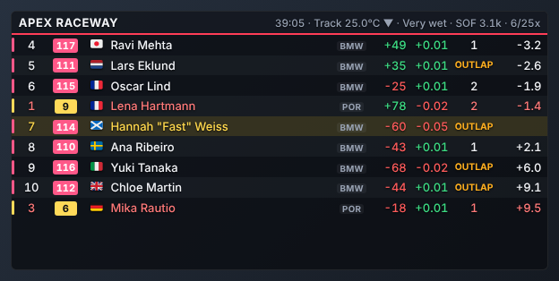
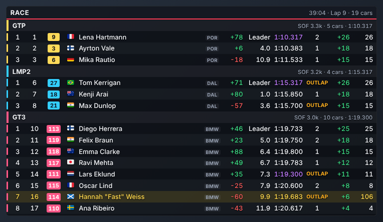
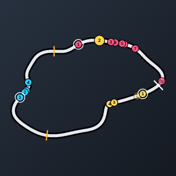
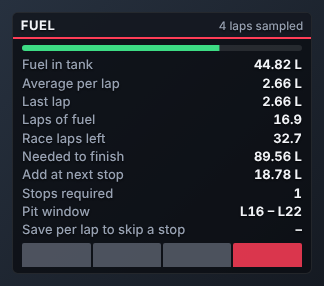
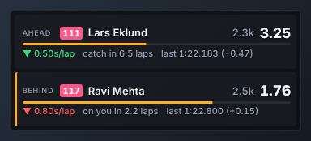
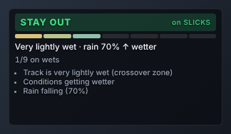
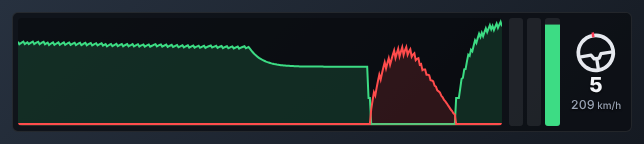
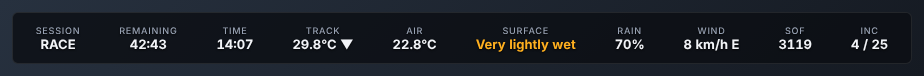

# Apex Overlays

A lightweight, fully customisable overlay suite for **iRacing**. It reads telemetry at the sim's native **60 Hz**,
does all the race maths once in a small native core (Rust), and draws each overlay as a minimal web page
in a transparent, click-through window. The same pages work as **OBS browser sources** for streaming.

| Relative | Standings (with league classes) | Track map |
|---|---|---|
|  |  |  |

| Fuel calculator | Battle box | Tyre advisor |
|---|---|---|
|  |  |  |




## Overlays

| Overlay | What it shows |
|---|---|
| **Relative** | Cars around you on track with colours for cars a lap ahead or behind. The gap column shows the time to each car on track, the gap to the class leader, or the gap to the car ahead (interval). |
| **Standings** | Multi-class leaderboard with gap to leader and interval. It shows the top rows and a window around you, per class or as one overall list. |
| **Track map** | Three styles: the **full circuit** (iRacing's official track map when you've set up the iRacing login, otherwise recorded automatically from your first clean lap; cached per track), a **flat** line (optionally one lane per class) and a **round** map. Includes **corner labels** (turn numbers like T3, names like Eau Rouge, or both), sector lines, start/finish, class-leader rings, rotation and mirroring. **Sector performance** paints each sector of your lap: purple when faster than your best, green when within 0.25 s of it (adjustable), yellow when slower. The colours stay for 5 s after you cross the line. |
| **Driver inputs** | Shift lights (per-gear shift points, flashing when it's time to shift), throttle, brake and clutch bars with their percentage above each bar, a scrolling input trace (ABS shown in colour), steering wheel, gear and speed. |
| **Fuel calculator** | The **usual consumption for this car and track** from earlier sessions (a few KB on disk), average/last/max use per lap, laps of fuel, race laps left (lap- or time-limited, lapped-car aware), fuel to finish, fuel to add, stops, pit window and how much to save to skip a stop. |
| **Battle box** | The car ahead and behind — in the race overall, in your class, or physically nearest on track (pick per overlay): gap, how fast it is closing (s/lap), laps until you catch them (or they catch you), and their last lap against yours. |
| **Flags** | A digital (LED-style) flag panel showing the flags out right now — green, yellow and waving yellow, caution, blue, white, chequered, red, black, meatball, furled black, debris, crossed flags, one-lap-to-green, 5/10 to go and more — plus start lights. Every flag can be switched on or off. |
| **Weather** | Live weather with a wind compass that turns with your car (or the car you are watching when spectating or in a replay), showing head/tail and crosswind, plus track and air temperature, humidity, pressure, sky, rain and wetness. |
| **Data box** | A small box with one value of your choice (speed, delta, fuel, position, gaps, track temperature, iRating change…). Add as many as you like, each with its own size and look. |
| **Tyre advisor** | Tells you when to change between slicks and wets (**BOX FOR WETS / BOX FOR SLICKS**). It combines track wetness, the rain trend, what your class is running and the wet/dry lap-time crossover, and explains why. |
| **Session info** | Track and air temperature (with trend), wetness, rain, declared wet, wind, humidity, sky, time or laps remaining, sim clock, SOF, incidents and flags. You can pick and order any of these fields. |
| **Garage 61** | Your Garage 61 personal best and your teams' best laps for the current car and track, compared with your session best. |

### Relative and standings columns

Every column has a title (it can be switched off), and you can toggle and reorder every column:

- class and overall position, car number, **country flag** (from the driver's iRacing flair; when a session doesn't include it, looked up once through the iRacing Data API if you have set that up, or set by hand in the League builder), driver, team
- **manufacturer** logo (logos for iRacing's manufacturers are built in; your own images in `%APPDATA%\Apex Overlays\logos\`, e.g. `porsche.png`, take priority), class, car, licence, iRating
- **iRating gain/loss** and **safety rating gain/loss** (live estimates), incidents
- current lap, **stint lap** (shows `PIT`, then `OUTLAP`, then 1, 2, 3… for the flying laps), **last lap** and **best lap** of every driver (purple = fastest of the class, green = a personal best), **tyre** (a white **D** badge for dry tyres, a blue **W** for wets)
- a **chequered flag** next to each driver's name once they have taken the flag at the end of the race
- **flags next to each driver**: a yellow when they caused one (off track or stopped on track), black flag, meatball (damage), furled black (warning) and blue flag
- a **penalty box** next to the black flag: `DT`, `S&G 40s` or `+5s` from *Race control*. When a black-flagged car serves its penalty in the pits, the box shows `DT` or a live `S&G` timer automatically.
- a **PIT** tag right after the driver's name while they are on pit road (OUT when they have left the car)
- gap and interval, positions gained, pit stops
- **league points** for the current position, and the **projected championship total**

The **header** of both overlays is also customisable. By default it shows the overlay's name with a coloured **session type badge** (Practice, Qualifying, Warmup, Race…). You can change the title (session, track, league or your own text) and add any session details next to it: time left, leader lap, track/air temperature with trend, wetness, rain, wind, SOF, incidents, flags and so on.

> iRacing doesn't publish its rating formulas. The iRating change uses the community formula most rating calculators use, so it's usually within a few points. The SR change is a rough corners-per-incident estimate that shows direction and approximate size, nothing more. Both are only shown in official races unless you change that under *General*. Other drivers' incidents are only visible in sessions where iRacing shares them.

### Customisation

- **Transparency per overlay:** each overlay has its own overall opacity and background opacity, and one button copies them to all overlays. Global defaults live in the theme.
- **Colour themes** restyle every overlay *and* the settings window. Text on coloured badges switches between white and black automatically, so it stays readable on bright accents such as yellow. There are 11 presets (Apex Overlays default, Midnight Blue, Racing Green, Papaya, Rosso, Monochrome, High Contrast, the team themes Gassed Up Motorsports, VCR and JWB, and Light). You can edit any colour, save your own themes, and export or import them as files.
- **Any overlay can be added more than once**, each copy with its own settings, size and scale.
- **Auto-fit height and width:** the window grows and shrinks with the number of rows and the columns you show (both on by default for Standings).
- **Move all overlays together:** in edit mode, drag one overlay and the rest follow, or nudge them all with the arrow buttons on the Overlays page.
- **Share settings:** export a single overlay (*Export…*) or your whole layout with its theme (*Share layout…*) to a file, and import overlays or layouts from others. Shared files contain no tokens, logins or leagues.
- **Every overlay** has its own scale, visibility rules (hide when iRacing isn't running, when you're not in the car, on pit road, or outside races) and **custom CSS**.
- **Column and field overlays** (relative, standings, session info) let you toggle and reorder every column, plus set name formats, gap signs and decimals.
- **The global theme** sets font, size and weight, every colour (player, lapped, lapping, pit, fastest, good/bad, caution), corner radius, row shading and padding, outline and text shadow.
- **Multiple copies of the same overlay** can run side by side with different settings, for example a compact relative for VR-style layouts and a full one for streaming.
- **Race control** (settings page) lets you hand out penalties by hand: drive-through, stop & go with its length, or added time. They're shown next to the driver's name. iRacing itself only reports *that* a black flag is out, not which penalty it is.
- **The League builder** switches leagues automatically: in a session of an iRacing league, the league you built (or imported) with that league ID is used, and in every other session (official races, other leagues) no league is applied. You can also choose to always use one league, e.g. for hosted sessions that aren't run as an iRacing league. It creates your own classes and assigns cars to them by car number, customer ID, driver or team name (wildcards), car model, car ID or iRacing class ID. You can also assign drivers in the current session from a dropdown, rename drivers and teams, set a driver's flag, or hide spectators.
  - **Import from iRacing by league ID** pulls the league name, roster nicknames, car classes, points system and championship standings. It needs iRacing Data API access (see below).
  - **Manual setup** covers league name, league ID, season, classes, points and bonuses, all typed by hand. **Pull drivers from current session** fills the driver roster automatically (names, car numbers, customer IDs). You then pick each driver's class and can add a nickname, team, flag or league car number.
  - **Create from current session** builds the classes *and* the roster from the session you're in, with no API needed.
  - **Points systems** score by **class or overall position** (leagues differ). There are presets (F1, MotoGP, IndyCar, …) or you can type or paste the table yourself. Optional bonus points cover fastest lap, pole position, leading a lap, most laps led and finishing (participation), plus points beyond the table. Live points and the projected championship total appear in the relative and standings.
  - Leagues import and export as JSON, so a league admin can share one file with everybody.
- **Strategy settings** cover the fuel averaging window and safety margin, the wet/dry thresholds and crossover margin for the tyre advisor, and the battle range.
- **Export and import** cover the whole setup.

## Download and install (Windows)

The **Code → Download ZIP** button on GitHub only gives you the source code, which has to be built first. Use one of these instead:

- **GitHub Releases (easiest):** when a version is tagged (e.g. `v0.2.0`), the *Release* workflow publishes
  `Apex Overlays_x.y.z_x64-setup.exe` (installer), `Apex-Overlays-portable.exe` and `apex-overlays-server.exe` on the repository's **Releases** page.
- **Latest CI build:** open the **Actions** tab, pick the newest green *CI* run, and download the `apex-overlays-windows` artifact (zip).
  You need to be signed in to GitHub to download artifacts.

From version 0.4.0 the app **updates itself**: it checks for new versions on start-up and under *Settings → General → Updates* (see [docs/UPDATES.md](docs/UPDATES.md)).

The app isn't code-signed yet, so Windows SmartScreen may say *"Windows protected your PC"*. Click **More info → Run anyway**.

## Getting started

1. Run the installer, or start the portable exe.
2. Start **Apex Overlays**. The settings window opens. The app lives in the system tray, and closing the settings window keeps the overlays running.
3. Press **Ctrl+Shift+E** (or *Edit mode* in settings) to drag and resize the overlays, then press it again to lock them. Locked overlays are click-through.
   Press **Ctrl+Shift+H** to show or hide everything. Both hotkeys can be changed.
4. Start iRacing. The overlays appear as soon as you are in a session.

WebView2 is already present on Windows 10/11. The installer fetches it if it is missing.

### Streaming (OBS)

Every overlay is a URL such as `http://127.0.0.1:8182/o/relative`. Add it as an OBS **Browser Source** with the overlay's size
(the *Streaming / OBS* page lists every URL). It has the same data, the same settings and a transparent background. To use a second streaming PC,
enable *Allow other PCs on my network* and use this PC's IP address.

### iRacing league import (Data API access)

iRacing only allows API access through OAuth. To import a league by ID you need a **client ID and secret** from iRacing
(request a "password limited" client from iRacing support) plus your iRacing email and password. Enter them under
*League builder → Import a league from iRacing*. The password and secret are stored only in the masked form iRacing's login expects.
iRacing's points-system endpoint only returns a name and description, so the points table is read from that description when it
lists the points. Otherwise pick a preset or type it in.

### Track, car and class data

Corner names and turn numbers, straight names, and pit entry and exit on the track map come from the community
[Lovely Track Data](https://github.com/Lovely-Sim-Racing/lovely-track-data) project. They are downloaded the first time you
drive a track and cached. For any track you can edit the corners, or add your own ("Add corner at my car's position"), under
*General → Track map & corners*.

Shift lights in the driver inputs overlay use per-gear shift points and colours from
[Lovely Car Data](https://github.com/Lovely-Sim-Racing/lovely-car-data) when your car is listed there, and iRacing's own shift
points otherwise. Short class names (GT3, TCR, LMP2…) come from [Lovely Car Classes](https://github.com/Lovely-Sim-Racing/lovely-car-classes)
and Lovely Car Data; switch them off under *General*. Class badges (GT3, LMP2, TCR, GTP, MX-5… 52 classes across sports cars, formula, oval and dirt) are built in and shown in
the standings class headers and the class column. Their colour follows the class colour of the session: iRacing's official
multiclass colours map to the matching badge colour (gold → yellow, light blue → sky, pink → magenta, purple → purple,
green → lime, single-class white → white), league colours to the closest badge colour, or pick *Exactly the class colour*
or a fixed colour. Your own image in `%APPDATA%\Apex Overlays\logos\` named after the class (e.g. `class-gt3.png`) takes priority.

### Without iRacing: the built-in simulator

`"Apex Overlays.exe" --mock` (or `apex-overlays-server --mock`) runs a three-class race with fuel use, pit stops and a rain shower that
comes and goes. Use it to set up layouts or develop new overlays.

## Building from source

Requirements: Rust (stable) and Node.js 20 or newer. For the desktop app on Windows you also need the
[Tauri prerequisites](https://v2.tauri.app/start/prerequisites/) (MSVC build tools + WebView2).

```sh
cd ui && npm ci && npm run build && cd ..   # overlay UI → ui/dist (embedded into the binaries)
cargo test                                  # core + SDK reader tests
cargo run -p apex-overlays-server -- --mock  # headless server + simulator → http://127.0.0.1:8182
# Windows desktop app:
cd apps/desktop && npx @tauri-apps/cli@2 build
```

For UI development, run `npm run watch` in `ui/` and `cargo run -p apex-overlays-server -- --mock --ui-dir ui/dist`, then reload the page.

## Project layout

```
crates/irsdk     iRacing shared-memory reader + tolerant session-info YAML parser (no dependencies)
crates/core      telemetry engine, calculators, league classes, Garage 61 client, HTTP/WebSocket server
apps/server      headless server binary (OBS / second PC / development)
apps/desktop     Tauri desktop host: transparent click-through overlay windows, tray, hotkeys
ui               overlays + settings panel (TypeScript, no framework, ~100 KB total)
docs             architecture, how to add an overlay, roadmap
```

See [docs/ARCHITECTURE.md](docs/ARCHITECTURE.md), [docs/ADDING_AN_OVERLAY.md](docs/ADDING_AN_OVERLAY.md) and
[docs/ROADMAP.md](docs/ROADMAP.md) (VR support, stream chat overlay and more).
